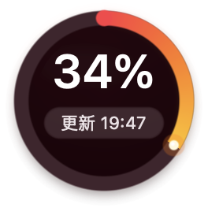
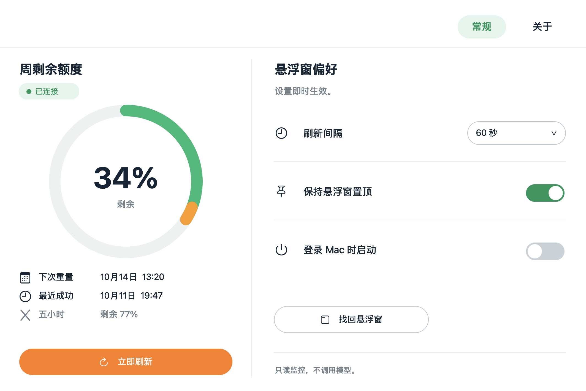
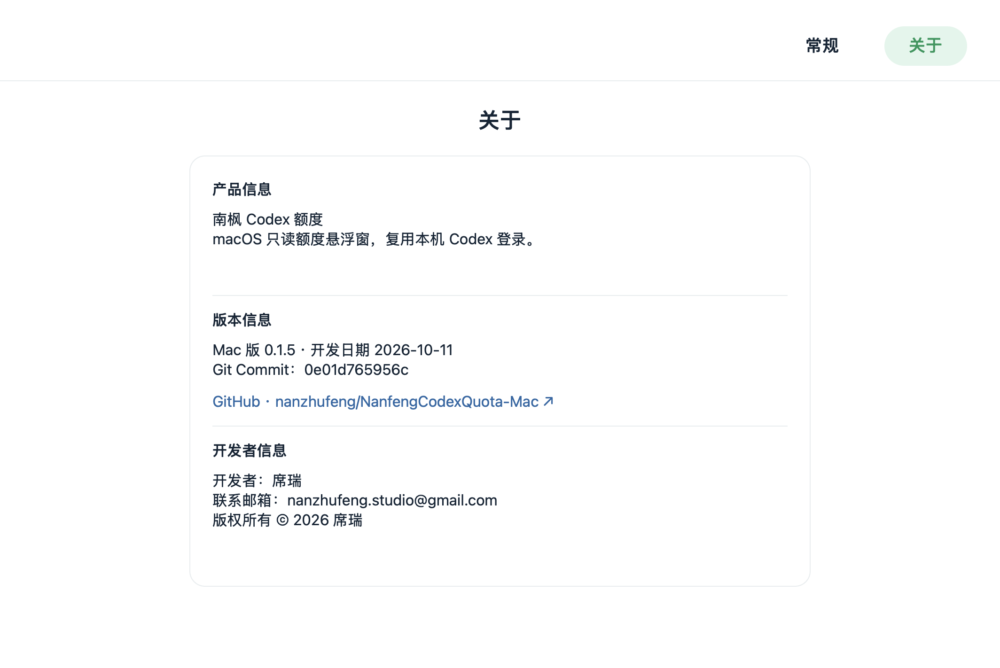

# 南枫 Codex 额度 · Mac

macOS 原生只读额度悬浮窗，复用本机 Codex 登录，无需保持 Codex 主窗口打开，不创建对话、不调用模型。

从 [Windows v0.1.4](https://github.com/nanzhufeng/NanfengCodexQuota-Windows) 完整移植原功能与设计，复用 Rust 额度核心及圆窗绘制，使用 AppKit 原生窗口和控件。

- 周剩余额度、重置时间、最近成功；接口提供五小时窗口时同步显示。
- 默认每 60 秒刷新，支持手动刷新、失败退避、过期标记、查询取消；失败保留最近成功值。
- 拖动并保存位置、置顶、隐藏找回、屏外恢复、单实例唤回、菜单栏和可选登录启动。
- 常规 / 关于两页保留白底绿橙仪表设计，原图标、真实构建 Git Commit 和本地修改标记。

## 安装与使用

支持 macOS 13+，Apple Silicon / Intel 通用二进制。[下载最新版安装包](https://github.com/nanzhufeng/NanfengCodexQuota-Mac/releases/latest)。打开 DMG，将“南枫 Codex 额度.app”拖到 Applications。先在 Codex 中登录，再运行应用。

GitHub 附件 `NanfengCodexQuota-Mac-v0.1.5-universal.dmg` 对应本地中文安装包“南枫Codex额度-Mac-v0.1.5-universal.dmg”；同版本提供 SHA-256 校验文件。

安装后可从系统应用列表或 Dock 找到应用。点击或双击菜单栏图标打开主界面；右键菜单栏或圆窗可刷新、打开主界面、切换置顶、隐藏 / 显示与退出。双击圆窗也可打开主界面。关闭设置窗口后额度监控继续运行。

登录启动默认关闭，开关显示真实系统状态；需要系统批准时会打开“系统设置 → 通用 → 登录项”。设置保存在 `~/Library/Application Support/NanfengCodexQuota/settings.toml`。删除应用不会删除设置或 Codex 登录。

当前发布包使用 ad-hoc 签名，尚未 Developer ID 签名或 Apple 公证，本机的默认 Gatekeeper 评估未通过，浏览器下载后可能被拦截。复制到 Applications 只完成安装文件，不能证明已获准启动。

首次打开被拦截时，如果你确认下载来源和 SHA-256 校验一致，需要你本人按 [苹果官方步骤](https://support.apple.com/zh-cn/102445) 在“系统设置 → 隐私与安全性”点“仍要打开”，再确认“打开”。应用不代替你作安全确认。登录项真实注册已通过；实际下次登录自动启动、多屏、睡眠唤醒、长期运行和 Intel 硬件尚需另行验收。

## 界面预览

Mac v0.1.5，生产提交 `0e01d76`，Apple Silicon / macOS 26.5.2 的真实原生运行页面。常规与关于内容区 1064×711 pt，悬浮窗 132×132 pt；额度来自隔离 fixture，截图不包含用户账户数据。






## 开发

Xcode Command Line Tools + Rust stable；无需 WebView、Electron 或 Python 运行时。Python 仅用于开发 QA 和正式发行配置校验。

```sh
rustup target add aarch64-apple-darwin x86_64-apple-darwin
cargo fmt --all --check
cargo clippy --all-targets --locked -- -D warnings
cargo test --all-targets --locked
./scripts/build-macos.sh --local
python3 scripts/qa-macos.py
```

架构、签名配置和验证边界见 [开发说明](docs/DEVELOPMENT.md)，完整功能对应见 [移植合同](docs/MAC_PORT.md)，本轮结果见 [项目状态](docs/PROJECT_STATUS.md)。基于 Apache-2.0；来源署名见 [NOTICE](NOTICE)。
